<div align="center">

# 🏄 Subway Surfers AI

### A real-time game-playing agent powered by a CNN and imitation learning

[](https://www.python.org/)
[](https://pytorch.org/)
[](LICENSE)
[](#demo)
[](#quick-start)

**Capture gameplay. Learn from demonstrations. Predict the next action.**

[Overview](#overview) · [Architecture](#architecture) · [Quick start](#quick-start) · [Dataset](#dataset) · [Demo](#demo) · [Roadmap](#roadmap)

</div>

---

## Overview

Subway Surfers AI learns to imitate human gameplay from labeled screenshots. The training pipeline preprocesses gameplay frames, stacks four consecutive frames to provide temporal context, and trains a compact convolutional neural network (CNN) to predict one of five actions. At runtime, the agent captures the screen, runs inference, and sends a keyboard input when its confidence reaches the configured threshold.

The repository includes the trained model checkpoint at `models/subway_cnn.pth`. The training dataset is not included; collect your own examples before training.

> **Current implementation:** supervised imitation learning with four-frame stacking. Reinforcement learning is a future roadmap item.

## Architecture

```mermaid
flowchart LR
    subgraph collect["1 · Collect demonstrations"]
        player["Player input"] --> recorder["Dataset recorder"]
        recorder --> classes["dataset/{jump,left,roll,right,noop}"]
    end

    subgraph train["2 · Train the policy"]
        classes --> preprocess["Crop game region<br/>Grayscale · resize to 96×96"]
        preprocess --> stack["Build 4-frame stacks<br/>Flip augmentation · swap left/right"]
        stack --> split["Train / validation split"]
        split --> cnn["SubwayCNN<br/>4-channel input · 5 action logits"]
        cnn --> checkpoint["Best validation checkpoint<br/>models/subway_cnn.pth"]
    end

    subgraph infer["3 · Play in real time"]
        screen["Screen capture"] --> live["Crop · grayscale · resize"]
        live --> buffer["Rolling 4-frame buffer"]
        buffer --> model["Load SubwayCNN checkpoint"]
        model --> confidence{"Confidence ≥ 0.90?"}
        confidence -->|Yes| action["Press predicted key"]
        confidence -->|No| noop["No action"]
        action --> screen
        noop --> screen
    end

    checkpoint -. "trained weights" .-> model
```



### Explore the components

| Component | What it does |
| --- | --- |
| [Dataset recorder](utilities/record_data.py) | Saves full-screen examples into action-labeled folders. |
| [Training pipeline](train_model.py) | Preprocesses and stacks frames, trains the CNN, and saves the best validation checkpoint. |
| [Runtime agent](play.py) | Captures the screen, buffers frames, predicts actions, and controls the game. |
| [Game-region configuration](config.py) | Defines the screen dimensions and crop used during preprocessing. |
| [Dependency configuration](pyproject.toml) | Declares Python version and project dependencies for `uv`. |

## Quick start

### Requirements

- Python 3.12 or newer
- [`uv`](https://docs.astral.sh/uv/getting-started/installation/)
- A desktop session where screen capture and keyboard input are available

Install the project dependencies from the repository root:

```bash
uv sync
```

### Run the pretrained model

The repository contains `models/subway_cnn.pth`, so you can start inference without training first:

```bash
uv run python play.py
```

The game region is configured in [`config.py`](config.py). Adjust it to match your display and game window before running the agent.

| Key | Behavior |
| --- | --- |
| `P` | Pause or resume inference |
| `Q` | Quit |

The agent defaults to `noop` when the predicted action confidence is below **90%**. The runtime loop uses screen capture and desktop keyboard input; keep the game visible and ensure your operating system permits those actions.

### Train a model

Training requires a locally collected `dataset/` directory with one folder per action. Once the dataset is ready, run:

```bash
uv run python train_model.py
```

The training script uses a 15% validation split, batches of 32, 25 epochs, Adam with a learning rate of `1e-3`, and cross-entropy loss. It automatically uses CUDA when available and otherwise runs on CPU. The checkpoint with the best validation accuracy is written to `models/subway_cnn.pth`.

## Dataset

### Record examples

Start the recorder while the game is open:

```bash
uv run python utilities/record_data.py
```

It creates `dataset/` and captures screenshots into action-specific folders. Use the following keys while playing:

| Key | Label |
| --- | --- |
| `W` | `jump` |
| `A` | `left` |
| `S` | `roll` |
| `D` | `right` |
| Automatically after every four action samples | `noop` |
| `Q` | Delete the most recently saved sample |
| `E` | Delete the three most recently saved samples |

### Preprocessing and augmentation

Each full-screen sample is cropped using `game_region` in `config.py`, converted to grayscale, and resized to **96 × 96**. The training dataset groups four chronological frames from the same action folder into each input stack. At the start of a folder's sequence, the earliest available frame is repeated to fill the stack. Horizontal-flip augmentation is applied consistently to all frames, with `left` and `right` labels swapped.

## Model

The CNN takes an input tensor shaped `[batch, 4, 96, 96]` and returns scores for five actions: `roll`, `left`, `noop`, `right`, and `jump`.

| Layer | Configuration | Output features |
| --- | --- | --- |
| Convolution + ReLU | 4 → 32 channels, kernel 8, stride 4 | 32 × 23 × 23 |
| Convolution + ReLU | 32 → 64 channels, kernel 4, stride 2 | 64 × 10 × 10 |
| Convolution + ReLU | 64 → 64 channels, kernel 3, stride 1 | 64 × 8 × 8 |
| Fully connected + ReLU | 4096 → 512 | 512 |
| Action head | 512 → 5 | 5 action scores |

## Demo

Recorded gameplay demo:

https://github.com/user-attachments/assets/fc41a001-06df-4953-b9a6-a2091082910f

## Project structure

```text
.
├── config.py                 # Display size and game-region crop
├── play.py                   # Real-time inference and keyboard control
├── train_model.py            # Dataset, CNN, and training pipeline
├── utilities/
│   └── record_data.py        # Labeled screenshot recorder
├── models/
│   ├── subway_cnn.pth        # Current four-frame model checkpoint
│   └── subway_surfers_cnn.pth
├── dataset/                  # Create locally with the recorder; not included
├── pyproject.toml
└── uv.lock
```

## Roadmap

- [x] Collect labeled gameplay screenshots
- [x] Train a CNN with imitation learning
- [x] Run real-time inference with confidence gating
- [x] Add four-frame stacking for temporal context
- [ ] Explore reinforcement learning on top of the pretrained model
- [ ] Add score-based reward signals using on-screen text recognition

## License

This project is released under the [MIT License](LICENSE).
